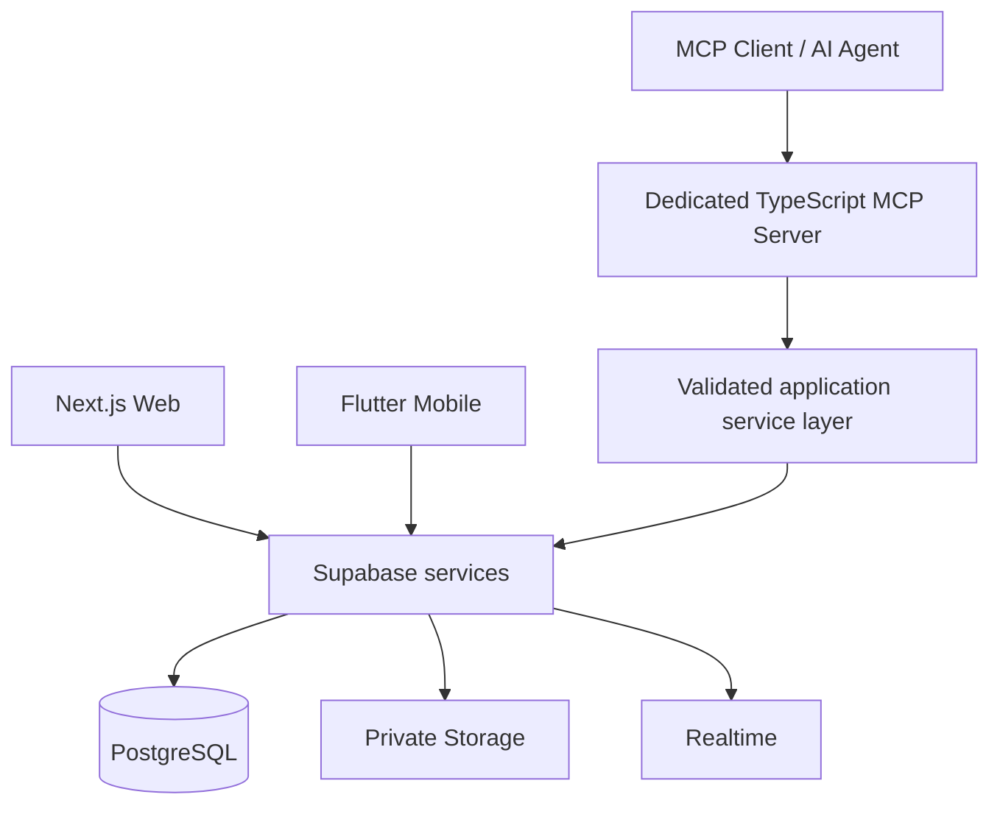

# Technical Architecture

## System context

## Component responsibilities
- Next.js: web UI, session-aware client, editor adapters, page navigation, search UI.
- Flutter: mobile UI, session handling, canonical block rendering/editing adapter.
- Supabase: database, Auth, RLS, private Storage, Realtime, full-text search.
- MCP service: transport, authentication, tool schemas, authorization, validation, idempotency, audit records, and calls to controlled service functions.
- Optional Edge Functions: only operations that need server-side execution close to Supabase and fit the runtime.
- Git migrations: canonical schema history.

## Data flow
Normal client writes should use authenticated Supabase operations subject to RLS and constraints. Sensitive multi-step operations should use a transaction/RPC or trusted server function. MCP operations go through the MCP service and must enforce the authenticated principal's permissions before mutating data.

## Boundaries
No client gets a service-role key. No agent gets arbitrary SQL. No privileged action is authorized merely because an LLM requested it. RLS is a second line of defense, not a substitute for MCP authorization.

## Deployment
- Web: Vercel or compatible Next.js host.
- MCP: long-running/HTTP-compatible service host supporting selected MCP transport.
- Backend: managed Supabase project.
- Mobile: Android build; app distribution process selected later.

## Realtime
Use Realtime for invalidation or useful updates, not as the sole consistency mechanism. Clients refetch authoritative data and handle stale revisions.

## Suggested repository
`apps/web`, `apps/mobile`, `apps/mcp`, `packages/contracts`, `packages/ts-shared`, `database/migrations`, `docs`. Flutter may remain a separate package/repository if monorepo tooling adds more complexity than value. Document the selected repository arrangement before implementation.

## Design constraints
Keep the first version understandable to a solo developer. Avoid microservices, event buses, or vector databases until a measured requirement justifies them.
